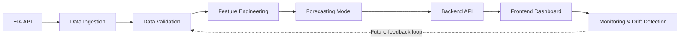

# Electricity Demand Forecasting with MLOps

> **Status:** data ingestion dan preprocessing dasar sudah tersedia; training model, API, dashboard, dan monitoring masih dalam pengembangan.

## Project Overview

Project ini membangun sistem forecasting permintaan listrik satu jam ke depan menggunakan machine learning dan praktik MLOps. Data yang digunakan adalah demand listrik **California ISO (CISO)** dengan frekuensi hourly dalam UTC.

## ML Task

- Tipe tugas: time-series regression
- Target: electricity demand pada **t+1 hour**
- Balancing Authority: **CISO**
- Metric data: **D — Demand**
- Frekuensi: hourly UTC

## Data Source

Data diambil dari [U.S. Energy Information Administration Open Data API v2](https://www.eia.gov/opendata/) melalui route `electricity/rto/region-data`. Pengumpul data meminta field `value`, respondent `CISO`, dan type `D`, kemudian mengurutkan hasil berdasarkan `period` secara ascending.

## Repository Structure

```text
MLOps-Electricity Demand Forecasting/
├── backend/                    # Future FastAPI service
├── config/                     # Konfigurasi data, model, dan pipeline
├── data/
│   ├── raw/                    # Respons API dalam format CSV
│   ├── interim/                # Data setelah preprocessing dasar
│   ├── processed/              # Data siap digunakan model
│   └── external/               # Data dari sumber eksternal lain
├── frontend/                   # Future React + Vite dashboard
├── models/                     # Model artifacts lokal
├── notebooks/                  # EDA dan eksperimen
├── scripts/                    # Lokasi utilitas operasional mendatang
├── src/
│   ├── data/                   # Client EIA dan fungsi preprocessing
│   └── pipelines/              # Entry point pengumpulan dan preprocessing data
└── tests/                      # Automated tests
```

Dokumentasi lebih rinci untuk komponen pengumpulan data tersedia di [`src/data/README.md`](src/data/README.md) dan [`src/pipelines/README.md`](src/pipelines/README.md).

## Persiapan Environment

Jalankan seluruh perintah dari root repository. Project memerlukan Python 3.11 atau yang kompatibel.

### PowerShell (Windows)

```powershell
python -m venv .venv
.\.venv\Scripts\Activate.ps1
python -m pip install -r requirements.txt
Copy-Item .env.example .env
```

### Bash (Linux, macOS, atau Codespaces)

```bash
python -m venv .venv
source .venv/bin/activate
python -m pip install -r requirements.txt
cp .env.example .env
```

Isi API key EIA di `.env`:

```dotenv
EIA_API_KEY=your_eia_api_key_here
```

API key dapat diperoleh dari halaman [EIA Open Data](https://www.eia.gov/opendata/register.php). File `.env` diabaikan oleh Git; jangan commit credential ke repository.

## Menjalankan Pengumpul Data

Subfolder output dibuat otomatis oleh fungsi penyimpanan. Jika ingin menyiapkannya sebelum eksekusi pertama, jalankan perintah berikut. CSV hasil unduhan diabaikan oleh Git; metadata `.dvc` dapat di-commit.

PowerShell:

```powershell
New-Item -ItemType Directory -Force data/raw/historical, data/raw/inference
```

Bash:

```bash
mkdir -p data/raw/historical data/raw/inference
```

### 1. Mengumpulkan data historis untuk training

```powershell
python -m src.pipelines.save_train_historical_data
```

Secara default, pipeline mengambil data per tahun mulai 2019 sampai tahun UTC saat ini. Setiap tahun dibagi menjadi dua request agar jumlah record per request tetap berada dalam batas API. File disimpan sebagai:

```text
data/raw/historical/ciso_historical.csv
```

Untuk memilih rentang tahun tertentu, panggil fungsinya secara langsung. Kedua batas tahun bersifat inklusif:

```powershell
python -c "from src.pipelines.save_train_historical_data import save_ciso_train_df; save_ciso_train_df(2022, 2024)"
```

### 2. Mengumpulkan data terbaru untuk inference

```powershell
python -m src.pipelines.save_inference_data
```

Pipeline inference meminta data dari tiga jam sebelum command dijalankan sampai jam UTC saat ini, lalu memilih satu record terbaru berdasarkan `period` dan menyimpannya sebagai:

```text
data/raw/inference/ciso_inference.csv
```

Karena publikasi data EIA dapat tertunda, respons pada jam terbaru mungkin kosong. Coba jalankan kembali setelah data tersedia.

### Verifikasi hasil

PowerShell:

```powershell
Get-ChildItem data/raw/historical, data/raw/inference -Filter *.csv
```

Bash:

```bash
find data/raw/historical data/raw/inference -name '*.csv'
```

Nama file tetap, sehingga eksekusi berikutnya menimpa CSV sebelumnya. Simpan versi yang ingin dipertahankan dengan DVC dan Git sebelum menjalankan pengumpulan ulang. Respons HTTP yang gagal, API key yang tidak valid, atau koneksi yang timeout akan menghentikan command dan menampilkan exception.

## Menambahkan Versi Data dengan DVC

Dataset historis dilacak melalui `data/raw/historical/ciso_historical.csv.dvc`. File ini mencatat hash, ukuran, dan lokasi CSV. Isi dataset disimpan dalam cache lokal `.dvc/cache/`, sedangkan Git menyimpan metadata `.dvc` dan riwayat commit. Jangan mengedit file cache secara manual.

### 1. Persiapan DVC

Aktifkan `.venv` seperti pada bagian persiapan environment. DVC sudah tercantum dalam `requirements.txt`, sehingga ikut terpasang saat menginstal dependency proyek. Jika environment sudah ada sebelum dependency ini ditambahkan, jalankan ulang instalasi:

```bash
python -m pip install -r requirements.txt
dvc --version
```

Repository ini sudah diinisialisasi dengan DVC. Hanya untuk repository baru yang belum memiliki `.dvc/`, jalankan sekali:

```bash
dvc init
git add .dvc .dvcignore
git commit -m "Initialize DVC"
```

### 2. Mengumpulkan dan mencatat versi baru

Jalankan dari root repository setelah mengisi API key EIA:

```bash
python -m src.pipelines.save_train_historical_data
dvc add data/raw/historical/ciso_historical.csv
dvc status
git diff -- data/raw/historical/ciso_historical.csv.dvc
git status --short
```

`dvc add` menyimpan isi terbaru ke cache dan memperbarui metadata. Jika isi CSV sama, hash tetap sama dan tidak ada perubahan metadata untuk di-commit. `dvc status` memeriksa kesesuaian data lokal dengan metadata; perubahan versi yang akan dicatat di Git terlihat melalui `git diff`.

Commit metadata untuk menyimpan versi tersebut:

```bash
git add .gitignore data/raw/historical/ciso_historical.csv.dvc
git commit -m "Update CISO historical dataset"
```

Jika DVC membuat atau mengubah `.gitignore` di subfolder data, stage file tersebut juga. Sertakan perubahan kode atau konfigurasi pengumpulan yang relevan dalam commit agar asal versi data dapat ditelusuri. Gunakan pesan commit yang menjelaskan rentang data atau alasan pembaruan.

Ulangi alur **pengumpulan → `dvc add` → pemeriksaan → commit Git** setiap kali ingin menambahkan versi. Nama CSV tetap sama; commit Git membedakan versinya. Untuk melacak dataset lain, gunakan alur yang sama dengan path CSV dan `.dvc` yang sesuai.

### 3. Membagikan data melalui remote

Saat ini `.dvc/config` belum berisi remote storage. Riwayat Git saja tidak menyimpan isi CSV, sehingga pemulihan versi memerlukan cache lokal atau remote DVC yang sudah berisi versi tersebut.

Setelah remote DVC dikonfigurasi, unggah isi data sebelum membagikan commit:

```bash
dvc push
git push
```

`dvc push` mengunggah data ke remote DVC; `git push` mengunggah kode dan metadata ke remote Git. Pada clone lain dengan remote dan akses yang sesuai, jalankan `dvc pull` untuk mengunduh data. Jika menggunakan Amazon S3, install dukungannya dengan `python -m pip install "dvc[s3]"` dan simpan credential di luar Git.

### 4. Memulihkan versi sebelumnya

Pastikan perubahan lokal yang ingin dipertahankan sudah disimpan, lalu lihat riwayat dataset:

```bash
git log --oneline -- data/raw/historical/ciso_historical.csv.dvc
```

Untuk memeriksa seluruh proyek pada commit tertentu, ganti `COMMIT_ID` dengan hash dari riwayat tersebut:

```bash
git switch --detach COMMIT_ID
dvc checkout data/raw/historical/ciso_historical.csv.dvc
```

`dvc checkout` memulihkan CSV dari cache lokal sesuai metadata pada commit yang dipilih. Jika cache versi itu tidak tersedia, gunakan `dvc pull data/raw/historical/ciso_historical.csv.dvc` setelah remote dikonfigurasi dan data versinya telah diunggah. CSV lokal akan diganti dengan versi yang dipilih.

Untuk kembali ke branch sebelumnya dan menyelaraskan CSV:

```bash
git switch -
dvc checkout data/raw/historical/ciso_historical.csv.dvc
```

### Jika metadata DVC diabaikan oleh Git

Jika `dvc add` menampilkan `bad DVC file name ... is git-ignored`, periksa aturan yang cocok:

```bash
git check-ignore -v data/raw/historical/ciso_historical.csv.dvc
```

Aturan `.gitignore` proyek mengabaikan isi `data/raw/`, tetapi mengizinkan penelusuran subfolder serta file `.dvc` dan `.gitignore`. Pertahankan pengecualian ini agar metadata bisa di-commit tanpa memasukkan CSV atau cache ke Git.

Referensi: [DVC add](https://doc.dvc.org/command-reference/add), [memperbarui data yang dilacak](https://doc.dvc.org/user-guide/how-to/update-tracked-data), dan [alur versioning dan pemulihan data](https://doc.dvc.org/start?tab=Mac-Linux).

## Preprocessing Dasar

Modul preprocessing mengubah `period` menjadi datetime UTC, mengubah `value` menjadi numerik, membuang duplikat dan nilai kosong, lalu mengurutkan data berdasarkan waktu. Untuk data training, modul juga membentuk kolom target `target_demand_1h` menggunakan demand pada baris satu jam berikutnya.

Fungsi preprocessing saat ini dipanggil dari Python dan belum mempunyai CLI tersendiri. Contoh penggunaan tersedia di [`src/pipelines/README.md`](src/pipelines/README.md).

## GitHub Codespaces

Repository menyediakan development container dengan Python 3.11. Setelah Codespace selesai dibuat, salin `.env.example` menjadi `.env`, isi `EIA_API_KEY` melalui secret Codespaces atau file lokal yang tidak di-commit, lalu jalankan modul pipeline dengan command yang sama seperti di atas.

## Security / Secret Management

Simpan secret hanya di `.env` lokal, GitHub Codespaces secrets, atau secret manager pada environment deployment. Jangan menaruh API key di `config/`, source code, notebook, CI configuration, atau dokumentasi.

## Development Roadmap

1. Initial project scaffold — selesai.
2. Exploratory data analysis — tersedia di folder `notebooks/`.
3. Data ingestion dan preprocessing dasar — sudah diimplementasikan.
4. Data validation dan feature engineering.
5. Model training, prediction, dan evaluation.
6. Backend API, frontend dashboard, monitoring, dan automated retraining.

## Project Architecture



Saat ini bagian yang telah tersedia adalah pengambilan data dari EIA dan preprocessing dasar. Komponen sesudahnya pada diagram masih merupakan target pengembangan.
